<div align="center">

# 🎨 Diagnoser — Client

### ממשק חכם לניהול מאבחנות, סדנאות והזמנות, עם בוט המלצות מבוסס AI

**Single Page Application** · **Role-Based UI** · **AI Chatbot** · **Hebrew Calendar**

<br/>


<br/>

[⚙️ צד השרת (ASP.NET Core)](https://github.com/Tauman-Chaya/C----Diagnoser) · [🎬 דמו](#-דמו-בוט-ה-ai-בפעולה) · [🏗️ ארכיטקטורה](#-ארכיטקטורה) · [🔐 הרשאות](#-ממשק-מבוסס-תפקידים) · [📸 צילומי מסך](#-צילומי-מסך) · [🚀 הרצה](#-התקנה-והרצה)

</div>

<br/>

<div dir="rtl">

## 📌 על הפרויקט

**Diagnoser** היא מערכת **Full-Stack** לניהול עסק של אבחונים וסדנאות בתחומי **מורפולוגיה**, **גרפולוגיה** ו**כירולוגיה**.
הריפו הזה הוא צד הלקוח: **SPA** ב-**React 18**, עם ניהול מצב מרכזי ב-**Redux Toolkit**, שמתחבר ל-[Web API ב-ASP.NET Core](https://github.com/Tauman-Chaya/C----Diagnoser).

הממשק מתאים את עצמו למי שמחוברת: **לקוחה**, **מאבחנת** או **מנהלת**. לכל אחת יש תפריט, מסכים ופעולות משלה. **בוט AI** מלווה את כל המשתמשות, ועוזר למצוא סדנה או מאבחנת בתוך שניות.

### ✨ יכולות מרכזיות

| | יכולת | תיאור |
|:---:|---|---|
| 🤖 | **בוט המלצות AI** | חלונית צ'אט צפה: ה-**LLM** מייצר 5 שאלות מותאמות, ומחזיר כרטיס המלצה עם הסבר, מחיר, פרטי המאבחנת וכפתור הזמנה |
| 🔐 | **Role-Based UI** | תפריט, נתיבים ופעולות שמשתנים לפי התפקיד: אורחת, לקוחה, מאבחנת או מנהלת |
| 📅 | **יומן אישי עברי** | **FullCalendar** בתצוגת חודש, שבוע ויום, עם **תאריך עברי** (‏hebcal) ופרטי כל הזמנה בלחיצה |
| 🎓 | **קטלוג סדנאות** | כרטיסי סדנאות לפי תחום וסוג קבוצה, עמוד פרטים מלא ובחירת מאבחנת |
| 🧾 | **תהליך הזמנה מלא** | בחירת תאריך, שעה ומקום, הפיכת מתעניינת ללקוחה, **שליחת מייל אוטומטית** למאבחנת ורישום עמלת 10% |
| 💰 | **לוח תשלומים למנהלת** | כמה נותר לתשלום אצל כל מאבחנת וצפייה בתורים שלה; המאבחנת מעדכנת תשלום מהפרופיל |
| 👥 | **ניהול לקוחות ומתעניינות** | טבלאות עם חיפוש וסינון, והיסטוריית הזמנות לכל לקוחה |
| 🔑 | **הרשמה והתחברות** | טופס עם ולידציה, או **Google Sign-In** (‏OAuth 2.0 ופענוח JWT) |
| ⚡ | **חוויית משתמש** | עיצוב RTL מלא, חלונות קופצים, אנימציות ו-**CSS Modules** לבידוד העיצוב |

<br/>

## 🎬 דמו: בוט ה-AI בפעולה

בוחרים "סדנה", עונים על השאלות שה-AI ייצר, ומקבלים המלצה מותאמת, עם מעבר ישיר להזמנה.

</div>

<div align="center">

https://github.com/user-attachments/assets/61567ed2-f378-44c7-92e9-2089df5ff531

<sub>🎬 32 שניות · מהשאלון ועד ההזמנה · <a href="docs/media/ai-bot-demo.mp4">פתיחה בדף נפרד</a></sub>

</div>

<br/>

<div dir="rtl">

## 🏗️ ארכיטקטורה

האפליקציה בנויה ב-**Feature-Based Architecture**: כל תחום (סדנאות, מאבחנות, הזמנות...) יושב בתיקייה משלו, עם הקומפוננטות, העיצוב וה-**Slice** שלו.
הקומפוננטות לא פונות לשרת ישירות. הן שולחות פעולה (**dispatch**), וה-**Async Thunk** מבצע את הקריאה ב-**Axios** ומעדכן את ה-**Store**. כך הנתונים זורמים בכיוון אחד (**Unidirectional Data Flow**).

</div>

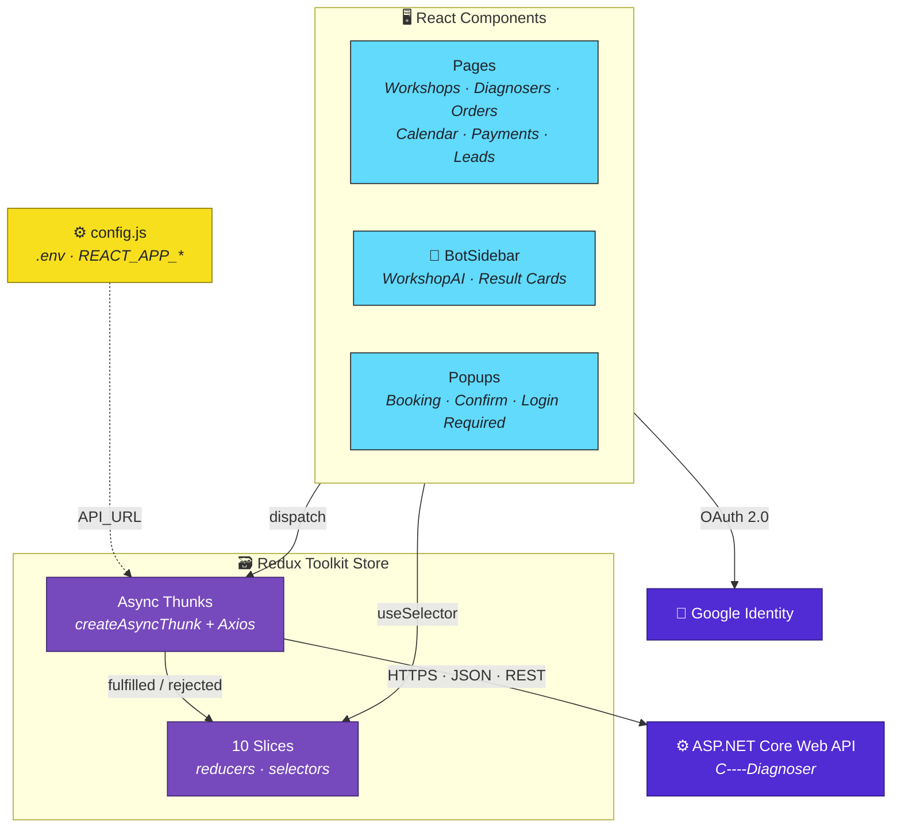

<div dir="rtl">

### 🗃️ מבנה ה-Store

| Slice | אחריות | נקודות קצה עיקריות |
|---|---|---|
| `WorkShop` | קטלוג הסדנאות, הוספה, עריכה ומחיקה | `/api/WorkShops/*` |
| `Diagnoser` | מאבחנות, יתרות ותשלום למנהלת | `/Diagnosers/*` |
| `Reference` | הזמנות: יצירה, עדכון, סגירה, תשלום וביטול | `/References/*` |
| `Customer` | לקוחות והיסטוריית הזמנות | `/Customers/*` |
| `Lead` | מתעניינות (נרשמו ועוד לא הזמינו) | `/Leads/*` |
| `LogIn` | המשתמשת המחוברת והתפקיד שלה | — |
| `Profile` | פרופיל אישי ותיאורי סוגי סדנאות | `/api/WorkShops/Type` |
| `WorkshopAI` | מצב הבוט: שאלות, תשובות, תוצאה וטעינה | `/api/AI/*` |
| `Status` · `TypeGroup` | טבלאות עזר: סטטוסי הזמנה וסוגי קבוצות | `/Statuses/*` |

> כתובת השרת מוגדרת במקום אחד, `src/config.js`, שקורא אותה מ-`.env`. כל ה-Slices משתמשים בה (**Single Source of Truth**).

<br/>

## 🤖 בוט ההמלצות

הבוט הוא חלונית צפה שזמינה בכל מסך. ה-AI עצמו רץ בשרת, והוא מקבל את רשימת הסדנאות או המאבחנות האמיתית מהמסד, כך שההמלצה תמיד מתאימה למה שקיים באמת.

</div>

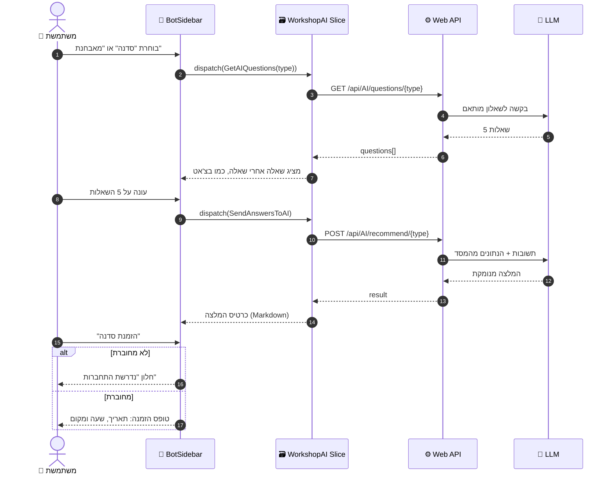

<div dir="rtl">

<br/>

## 🔐 ממשק מבוסס תפקידים

אחרי ההתחברות, `LogInSlice` מזהה את סוג המשתמשת, והתפריט והנתיבים נבנים לפי התפקיד. כל תפקיד מקבל את מה שיש לקודם, ועוד יכולות משלו.

</div>

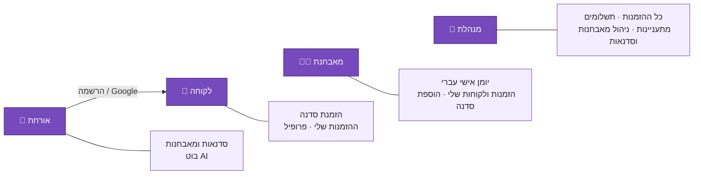

<div dir="rtl">

| מסך | 👀 אורחת | 🙋 לקוחה | 👩‍⚕️ מאבחנת | 👑 מנהלת |
|---|:---:|:---:|:---:|:---:|
| סדנאות ומאבחנות | ✅ | ✅ | ✅ | ✅ |
| בוט AI | ✅ | ✅ | ✅ | ✅ |
| הזמנת סדנה | 🔒 נדרשת התחברות | ✅ | ✅ | ✅ |
| ההזמנות שלי | — | ✅ | ✅ | ✅ (כולן) |
| הוספת סדנה | — | — | ✅ | ✅ |
| יומן אישי | — | — | ✅ | ✅ |
| לקוחות | — | — | ✅ | ✅ |
| תשלומים | — | — | — | ✅ |
| מתעניינות | — | — | — | ✅ |
| הוספה ומחיקה של מאבחנות | — | — | — | ✅ |

<br/>

## 🛒 תהליך הזמנה

</div>

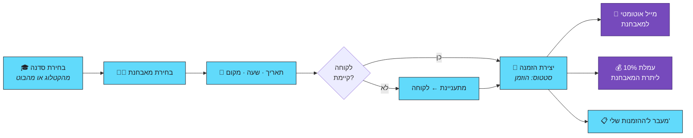

<div dir="rtl">

<br/>

## 📸 צילומי מסך

> הצילומים מוצגים עם [נתוני הדמה](https://github.com/Tauman-Chaya/C----Diagnoser/blob/main/Database/schema.sql) של השרת.

</div>

<table>
  <tr>
    <td align="center" width="50%">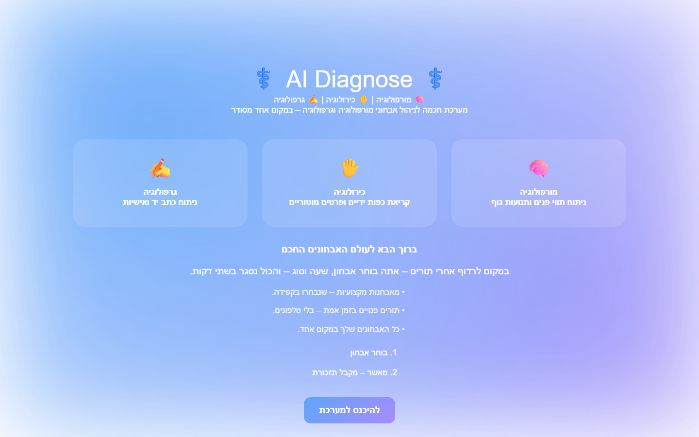<br/><b>🏠 דף הבית</b></td>
    <td align="center" width="50%">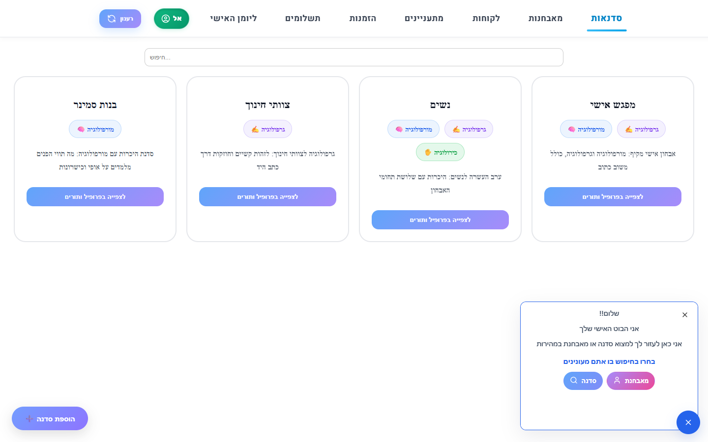<br/><b>🤖 בוט ה-AI</b></td>
  </tr>
  <tr>
    <td align="center">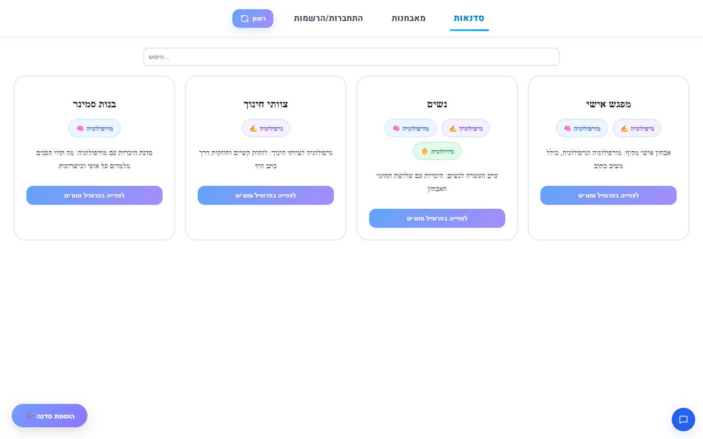<br/><b>🎓 קטלוג הסדנאות</b></td>
    <td align="center">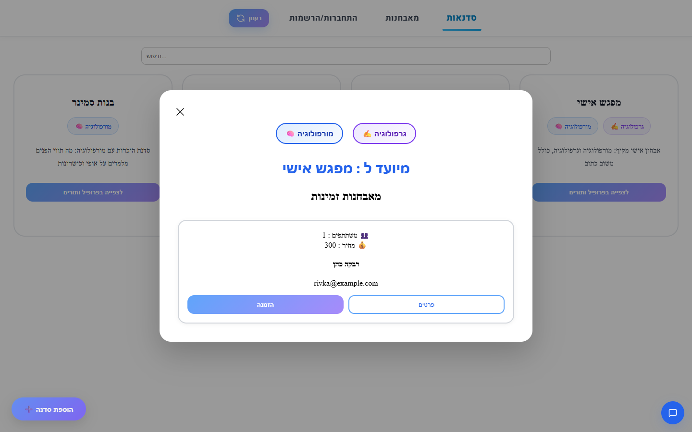<br/><b>📄 פרטי סדנה</b></td>
  </tr>
  <tr>
    <td align="center">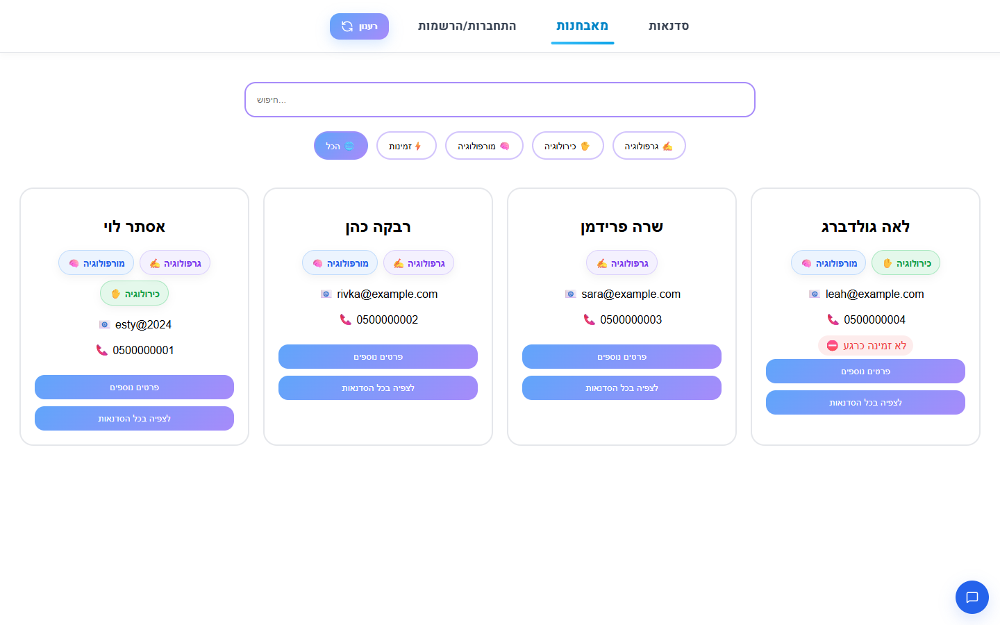<br/><b>👩‍⚕️ המאבחנות</b></td>
    <td align="center">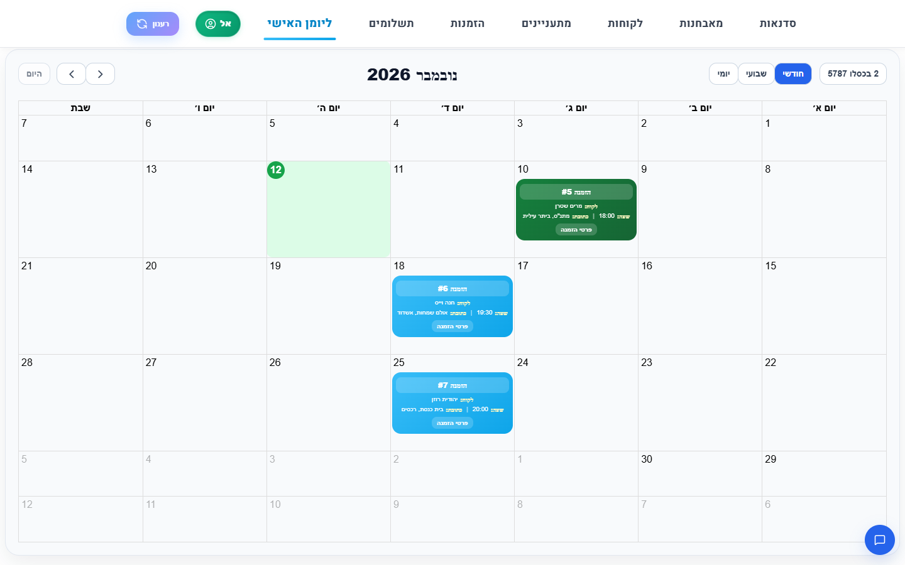<br/><b>📅 יומן אישי עברי</b></td>
  </tr>
  <tr>
    <td align="center">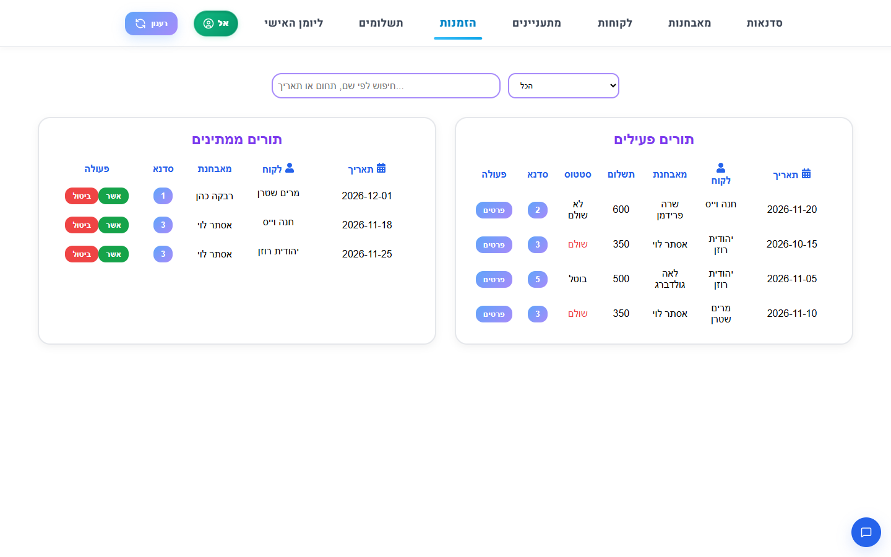<br/><b>🧾 הזמנות</b></td>
    <td align="center">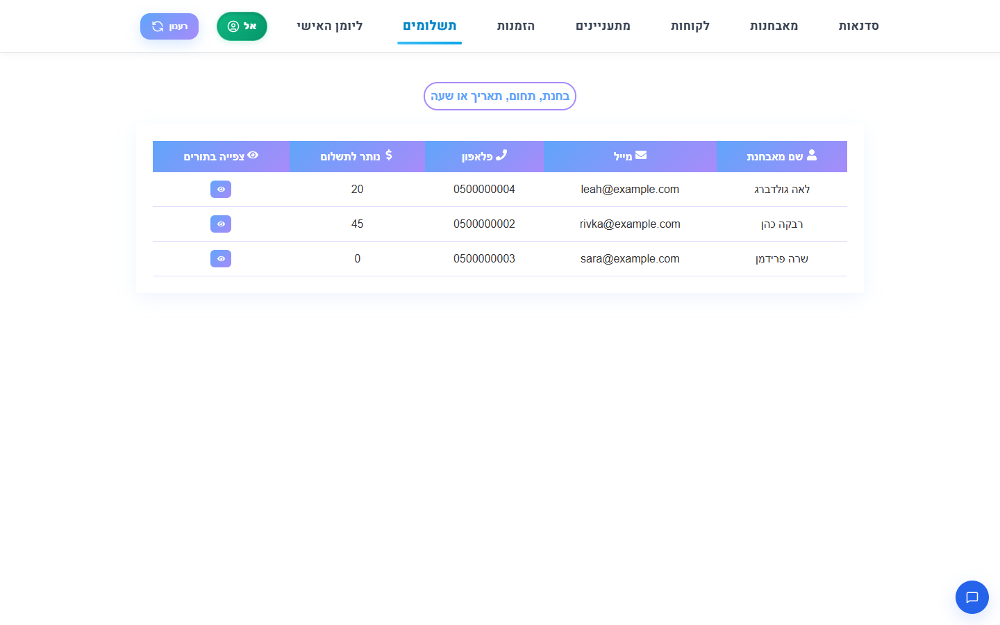<br/><b>💰 תשלומים (מנהלת)</b></td>
  </tr>
  <tr>
    <td align="center">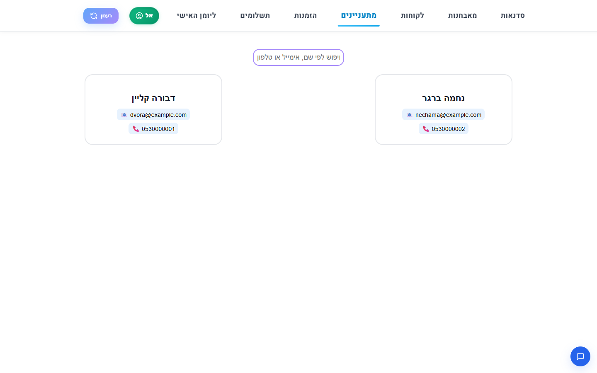<br/><b>📋 מתעניינות (מנהלת)</b></td>
    <td align="center">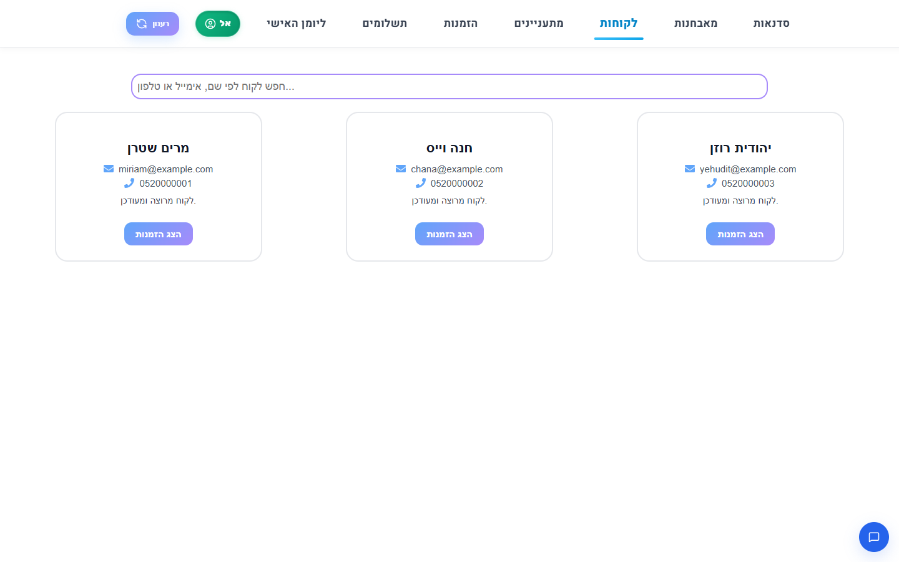<br/><b>👥 לקוחות</b></td>
  </tr>
  <tr>
    <td align="center">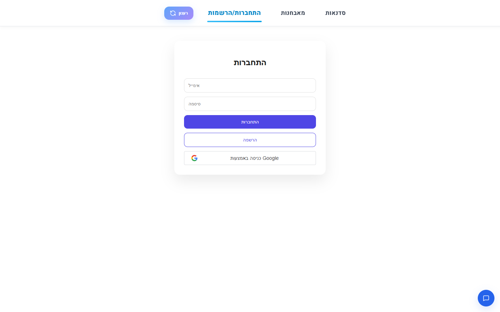<br/><b>🔑 התחברות (כולל Google)</b></td>
    <td align="center">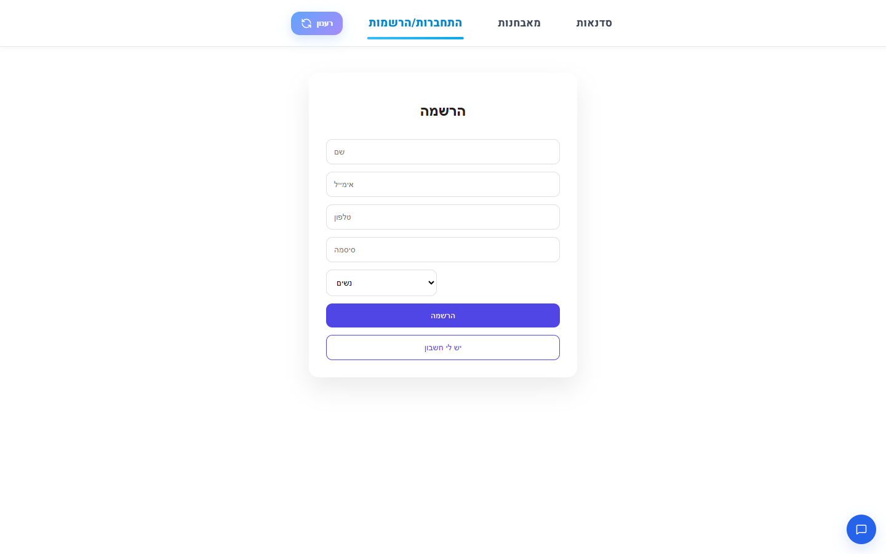<br/><b>✍️ הרשמה</b></td>
  </tr>
</table>

<div dir="rtl">

<br/>

## 🛠️ טכנולוגיות

| תחום | טכנולוגיה |
|---|---|
| **Framework** | React 18 (Create React App), JSX, Hooks |
| **State Management** | Redux Toolkit: ‏`createSlice`, ‏`createAsyncThunk`, ‏React-Redux |
| **Routing** | React Router 6, כולל נתיבים דינמיים (`/WorkshopDetails/:code`) |
| **HTTP** | Axios, ‏REST, ‏JSON |
| **Calendar** | FullCalendar 6 (DayGrid, TimeGrid, Interaction), לוקליזציה לעברית, ‏hebcal |
| **Authentication** | Google Identity Services (‏`@react-oauth/google`), ‏`jwt-decode` |
| **AI Output** | `react-markdown` + ‏`remark-gfm` להצגת ההמלצה המעוצבת |
| **Styling** | CSS Modules, ‏RTL, ‏`lucide-react` ו-`react-icons` |
| **Configuration** | משתני סביבה (`.env`, ‏`REACT_APP_*`) |

<br/>

## 📂 מבנה הפרויקט

</div>

```text
React---Diagnoser/
├── public/                     # index.html, manifest, אייקונים
├── docs/
│   ├── screenshots/            # צילומי המסך שב-README
│   └── media/                  # סרטון הדמו של הבוט
├── src/
│   ├── index.js                # Provider · GoogleOAuthProvider · BrowserRouter
│   ├── App.jsx                 # תפריט לפי תפקיד + הגדרת הנתיבים
│   ├── config.js               # API_URL, MANAGER_EMAIL, GOOGLE_CLIENT_ID
│   ├── app/
│   │   └── store.js            # configureStore – 10 Slices
│   ├── components/
│   │   └── BotSidebar/         # חלונית הבוט הצפה
│   └── features/               # Feature-Based: קומפוננטות + עיצוב + Slice
│       ├── AI/                 # WorkshopAI, כרטיסי תוצאה, חלון "נדרשת התחברות"
│       ├── Calendar/           # יומן אישי ובוחר תאריך עברי
│       ├── WorkShop/           # קטלוג, פרטים, הוספה והזמנה
│       ├── Diagnosers/         # רשימה, פרטים, הוספה ומחיקה
│       ├── References/         # הזמנות, אישור, ביטול ותשלום
│       ├── Customers/          # לקוחות והזמנות של לקוחה
│       ├── Leads/              # מתעניינות
│       ├── Profile/            # פרופיל ותשלומים למנהלת
│       ├── SignIn/             # התחברות, הרשמה ותפריט משתמשת
│       ├── Email/              # שליחת מיילים דרך השרת
│       └── Home/ · Statuss/ · TypeGroup/
├── .env                        # ברירות מחדל (ללא סודות)
└── package.json
```

<div dir="rtl">

<br/>

## 🚀 התקנה והרצה

### דרישות מקדימות

- [Node.js](https://nodejs.org/) גרסה 18 ומעלה
- [צד השרת](https://github.com/Tauman-Chaya/C----Diagnoser) רץ בכתובת `https://localhost:7082` (ההוראות ב-README שלו)

### 1. שכפול והתקנה

</div>

```bash
git clone https://github.com/Tauman-Chaya/React---Diagnoser.git
cd React---Diagnoser
npm install
```

<div dir="rtl">

### 2. הגדרות (לא חובה)

ברירות המחדל נמצאות ב-`.env`, ומתאימות לשרת ולנתוני הדמה. כדי לשנות משהו רק במחשב שלך, יוצרים קובץ `.env.local` (הוא לא עולה ל-git):

</div>

```env
REACT_APP_API_URL=https://localhost:7082
REACT_APP_MANAGER_EMAIL=esty@2024
REACT_APP_GOOGLE_CLIENT_ID=<your-client-id>.apps.googleusercontent.com
```

<div dir="rtl">

### 3. הרצה

</div>

```bash
npm start
```

<div dir="rtl">

האפליקציה נפתחת בכתובת **http://localhost:3000**.

**משתמשות לדוגמה** (מנתוני הדמה של השרת, סיסמה `1234`):

| תפקיד | מייל |
|---|---|
| 👑 מנהלת | `esty@2024` |
| 👩‍⚕️ מאבחנת | ראו טבלת `Diagnosers` ב-[schema.sql](https://github.com/Tauman-Chaya/C----Diagnoser/blob/main/Database/schema.sql) |

> 💡 `DISABLE_ESLINT_PLUGIN=true` ב-`.env` מכבה את בדיקת ה-ESLint של create-react-app בזמן הריצה, כי היא לא תואמת ל-Node 24.

<br/>

## 🔗 פרויקטים קשורים

| | ריפו | תיאור |
|:---:|---|---|
| ⚙️ | **[C----Diagnoser](https://github.com/Tauman-Chaya/C----Diagnoser)** | צד השרת: ASP.NET Core 8 Web API, ‏N-Tier, ‏EF Core, מנוע ה-AI |
| 🎨 | **[React---Diagnoser](https://github.com/Tauman-Chaya/React---Diagnoser)** | צד הלקוח: React 18, ‏Redux Toolkit, יומן עברי, בוט AI *(אתם כאן)* |

<br/>

<div align="center">

---

### 👩‍💻 פותח על ידי **חיה טאומן** ו**מלי אורלינסקי**

[](https://github.com/Tauman-Chaya)
[](https://github.com/Maly-Orlinsky)

⭐ אם הפרויקט מצא חן בעינייך, אשמח לכוכב!

</div>

</div>
